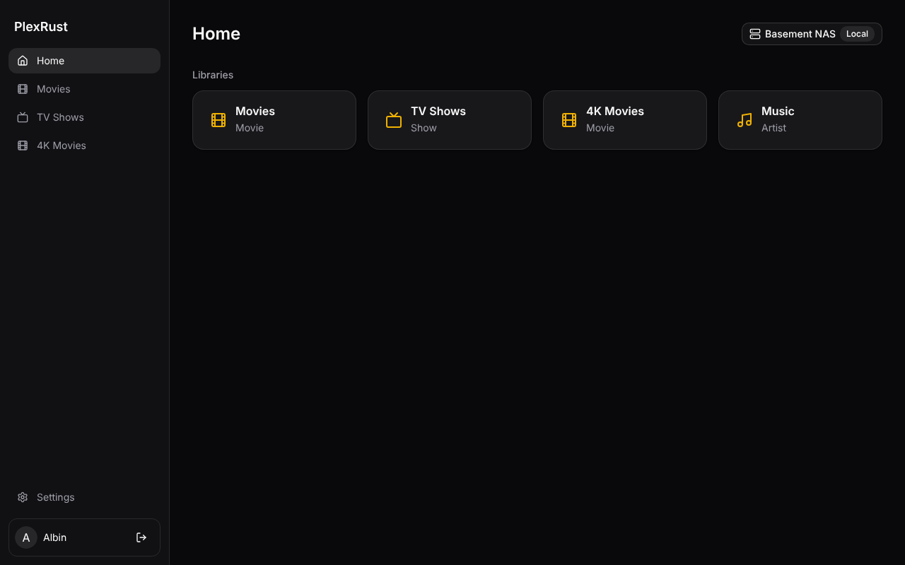

# PlexRust

A fast Plex player for Windows, in the spirit of Infuse. The core (Plex API,
playback control, settings) is Rust; the interface is React with
[shadcn/ui](https://ui.shadcn.com) running in [Tauri 2](https://tauri.app).

## Status

- [x] Sign in with Plex (plex.tv PIN, approved in the browser)
- [x] Server discovery, picking the fastest connection (local, then remote, then relay)
- [x] Library browsing: home rows, virtualized poster grids, movie/show/season/episode pages, search
- [x] Player: embedded mpv, direct play (HDR passthrough), optional server transcode, audio/subtitle picker, progress sync
- [ ] Auto-skip intros and credits from Plex markers, settings page

## Layout

| Path | What |
| --- | --- |
| `crates/plex` | Async client for plex.tv and Plex Media Server. No Tauri dependency, unit tested. |
| `src-tauri` | The Tauri app: commands the UI calls, persisted settings. |
| `src` | React UI. `components/ui` holds shadcn/ui components. |

Settings (including the Plex token) are stored in
`%APPDATA%\com.lordendor.plexrust\settings.json`.

## Playback

Videos play in [mpv](https://mpv.io), embedded in the app window through
`tauri-plugin-mpv` (mpv runs as a child process controlled over JSON IPC and
draws underneath the transparent webview). CI downloads a Windows mpv build
into `src-tauri/mpv/` and bundles it with the installer. For `pnpm tauri dev`,
put `mpv` on your PATH or extract a build into `src-tauri/mpv/`.

## Developing on Windows

1. Install [Rust](https://rustup.rs), [Node.js 22+](https://nodejs.org) and
   pnpm (`npm i -g pnpm`). WebView2 ships with Windows 11.
2. `pnpm install`
3. `pnpm tauri dev` runs the app with hot reload.
4. `pnpm tauri build` produces an installer under `target/release/bundle`.

## Updates

Every merge to `main` publishes a signed release (`v0.1.<run number>`) via
`.github/workflows/release.yml`. On launch the app checks
`releases/latest/download/latest.json`, downloads a newer build in the
background and offers **Restart to update**.

Releases are signed with the updater key: its public half is in
`src-tauri/tauri.conf.json`, the private half is the
`TAURI_SIGNING_PRIVATE_KEY` repository secret. Lose the private key and
installed copies can no longer update, so keep a backup of it.
